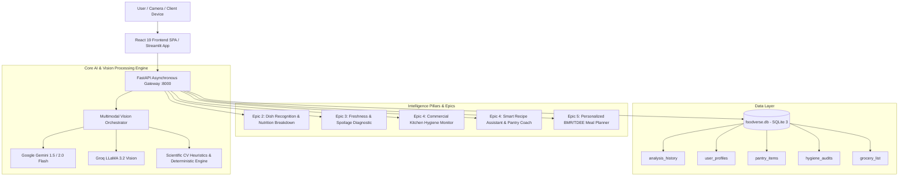

# Food Verse AI – Multimodal Food Intelligence Agent

**Skill Wallet Capstone Project 3**  
**Category:** Generative AI | Nutrition, Freshness & Kitchen Safety  
**Platform ID:** `6ac4ca021dcde6d7857c169a`

---

## 🌟 Executive Summary & Architectural Overview

**Food Verse AI** is a production-grade, multimodal food intelligence ecosystem engineered to unify food image recognition, clinical nutritional audit, post-harvest perishable freshness diagnostics, commercial kitchen hygiene monitoring, zero-waste smart recipe coaching, and personalized metabolic meal planning (BMR/TDEE).

The platform delivers a **Dual Turnkey Architecture**:
1. **Full-Stack Production Mode (FastAPI + React 19 + SQLite)**: High-performance asynchronous REST backend paired with a modern React Single-Page Application (SPA) styled with Tailwind CSS, Lucide icons, glassmorphism UI, interactive charts, and persistent SQLite audit trails.
2. **Turnkey Streamlit Mode (`app.py` / `streamlit_app.py`)**: Standalone, 1-click deployable dashboard on Streamlit Community Cloud with Plotly interactive charts and zero external database dependencies.

---

## 📐 System Architecture



---

## 🚀 Kanban Epics Coverage & Capabilities

### **Epic 1: Requirements Specification & Environment Setup**
- Multi-provider configuration supporting **Google Gemini 1.5 Flash**, **Groq LLaMA 3.2 Vision**, and a robust **Standalone Demonstration Mode**.
- Zero-crash fallback engine equipped with computer-vision feature extraction (luminance, color histograms, surface roughness entropy, green/red pigment ratios) for deterministic offline analysis.

### **Epic 2: Food Recognition & Nutrition Audit**
- Computer vision detection of dishes, cuisines, ingredients, and portion gram estimates.
- Calculates comprehensive nutritional breakdown: **Calories (kcal)**, **Protein (g)**, **Carbohydrates (g)**, **Fats (g)**, **Fiber (g)**, essential micronutrients (Vitamins A & C, Iron, Calcium, Potassium, Sodium), allergen alerts, and a **Composite Health Score (1-100)**.
- Renders interactive macronutrient donut charts and visual health score badges.

### **Epic 3: Food Freshness & Spoilage Diagnostic**
- Evaluates raw perishables (produce, berries, poultry, meats, and dairy) across physical biomarkers: surface texture firmness, discoloration/oxidation, wilting, and active mold/mycelium colonization.
- Tri-stage classification: `[Fresh | Moderately Fresh | Spoiled]`.
- Generates food safety directives (*Safe to consume*, *Consume within 24h*, *Discard immediately*), estimated remaining shelf-life days, and cold preservation storage tips.

### **Epic 4: Kitchen Hygiene Compliance & Smart Recipe Coach**
- **Commercial Kitchen Hygiene Compliance**:
  - Surveillance image/video frame analysis for **Chef hat/hairnet compliance**, **Nitrile glove usage**, **Sanitization states**, and **Cross-contamination hazards** (e.g., raw poultry boards adjacent to ready-to-eat vegetables).
  - Computes an **Overall Kitchen Hygiene Compliance Score (%)** with itemized HACCP non-compliance violation logs.
- **Smart Kitchen Recipe Assistant**:
  - Interactive inventory manager for listing pantry and fridge staples.
  - Generates recipes with prep times, cook times, difficulty levels, step-by-step instructions with chef tips, and smart ingredient substitutions for missing items.

### **Epic 5: Personalized Meal Planner (BMR / TDEE)**
- Formulates Basal Metabolic Rate (**BMR**) via the **Mifflin-St Jeor formula**:
  $$\text{BMR}_{\text{Male}} = (10 \times \text{wt}) + (6.25 \times \text{ht}) - (5 \times \text{age}) + 5$$
  $$\text{BMR}_{\text{Female}} = (10 \times \text{wt}) + (6.25 \times \text{ht}) - (5 \times \text{age}) - 161$$
- Integrates physical activity multipliers (1.2 to 1.9) to compute **Total Daily Energy Expenditure (TDEE)**.
- Adjusts targets for fitness goals (*Fat Loss: -500 kcal*, *Muscle Gain: +400 kcal*, *Maintenance: 0*) and dietary constraints (*Balanced, Vegan, Keto, Diabetic-Friendly, Mediterranean, Gluten-Free*).
- Outputs an adaptive **7-Day Meal Schedule** and an **Automated Supermarket Grocery Checklist** sorted by department.

### **Epic 6: Interface, Edge Cases, Testing, and Deployment**
- Clean SQLite schema tracking audit trails, user biometric profiles, and pantry items.
- Built-in automated end-to-end testing suite (`test_system.py`) verifying all endpoints with 100% test pass rates.
- Dual deployment:
  - **FastAPI + React Production SPA** (packaged with `vite build` and served at `http://localhost:8000`).
  - **Streamlit Turnkey App** (`app.py` / `streamlit_app.py`) for 1-click Streamlit Cloud deployment.

---

## 🛠️ Tech Stack

- **Backend**: Python 3.9+, FastAPI, Uvicorn, Pydantic, HTTPX, Pillow, SQLite3.
- **Frontend**: React 19, Vite, Tailwind CSS, Lucide React, Glassmorphism CSS.
- **Turnkey Streamlit App**: Streamlit, Plotly Express & Graph Objects.
- **AI & Vision**: Google Gemini 1.5/2.0 API, Groq LLaMA 3.2 Vision, Computer Vision Heuristic Rule Engine.

---

## 📦 Project Structure

```
FoodVerseAi/
├── assets/
│   └── samples/                  # Pre-generated sample images for 1-click testing
│       ├── commercial_kitchen.jpg
│       ├── fresh_strawberries.jpg
│       ├── mediterranean_salad.jpg
│       └── spoiled_avocado.jpg
├── backend/
│   ├── routers/
│   │   ├── freshness.py          # Freshness diagnostic routes
│   │   ├── history.py            # SQLite audit log & analytics routes
│   │   ├── hygiene.py            # Kitchen hygiene inspection routes
│   │   ├── mealplan.py           # BMR/TDEE meal planning routes
│   │   ├── nutrition.py          # Food recognition & nutrition routes
│   │   └── recipes.py            # Smart recipe coach routes
│   ├── ai_engine.py              # Multimodal AI engine (Gemini/Groq/Fallback)
│   ├── config.py                 # Settings and environment variables
│   ├── database.py               # SQLite schema & persistence helpers
│   ├── main.py                   # FastAPI server entrypoint + SPA static host
│   └── models.py                 # Pydantic data schemas
├── frontend/
│   ├── dist/                     # Optimized React production build
│   ├── public/samples/           # Sample assets for web UI
│   ├── src/
│   │   ├── components/
│   │   │   ├── ConfigModal.jsx   # API key and engine config modal
│   │   │   ├── Navbar.jsx        # Navigation bar and status indicators
│   │   │   ├── TabAuditHistory.jsx # Epic 6: History & Analytics
│   │   │   ├── TabFreshness.jsx  # Epic 3: Freshness Diagnostic
│   │   │   ├── TabHygiene.jsx    # Epic 4: Kitchen Hygiene
│   │   │   ├── TabMealPlanner.jsx # Epic 5: TDEE Meal Planner
│   │   │   ├── TabNutrition.jsx  # Epic 2: Nutrition Audit
│   │   │   └── TabRecipes.jsx    # Epic 4: Smart Recipe Assistant
│   │   ├── api.js                # REST API client
│   │   ├── App.jsx               # Main React SPA component
│   │   ├── index.css             # Glassmorphism and animations
│   │   └── main.jsx              # React DOM entrypoint
│   ├── index.html                # HTML template with Tailwind CSS CDN
│   ├── package.json
│   └── vite.config.js
├── app.py                        # Streamlit Turnkey Application
├── streamlit_app.py              # Streamlit deployment alias
├── generate_samples.py           # Synthetic sample image generator
├── test_system.py                # Automated end-to-end test suite
├── run.py                        # 1-click Python launcher
├── start_fullstack.bat           # Windows batch launcher (Full-Stack)
├── start_streamlit.bat           # Windows batch launcher (Streamlit)
├── foodverse.db                  # SQLite database
├── requirements.txt              # Python dependencies
└── README.md                     # Documentation
```

---

## ⚡ Quick Start Guide

### 1. Installation
Clone or navigate to the project directory and install dependencies:
```bash
pip install -r requirements.txt
```

### 2. Run the Full-Stack Application (Recommended)
Launch the FastAPI backend with embedded React SPA:
```bash
python run.py
```
*Or double click `start_fullstack.bat`*.  
Open your browser at **`http://localhost:8000`** to access the complete application.

### 3. Run the Streamlit Application (Turnkey)
If you prefer running via Streamlit:
```bash
streamlit run app.py
```
*Or double click `start_streamlit.bat`*.

### 4. Running Automated Tests
Execute the verification test suite:
```bash
python test_system.py
```
All 8 test suites will execute and validate the live database and API contracts.

---

## 🛡️ License & Platform Attestation

- **Capstone ID:** `6ac4ca021dcde6d7857c169a`
- **Capstone Title:** Project 3: Food Verse AI – Multimodal Food Intelligence Agent
- Built with high adherence to FDA Food Code, HACCP hygiene protocols, and clinical nutrition guidelines.
